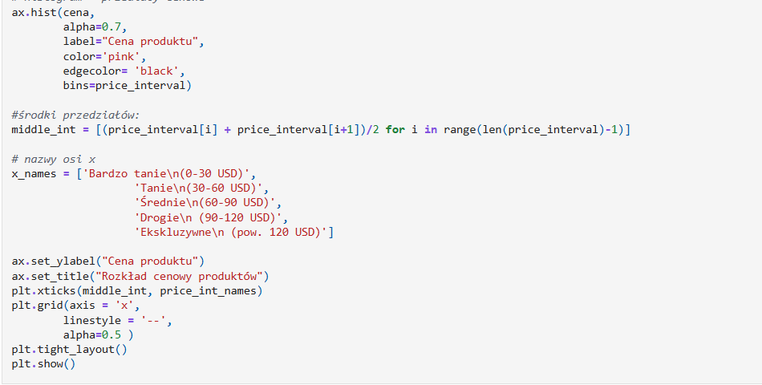
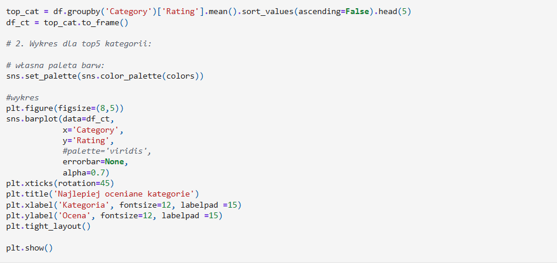
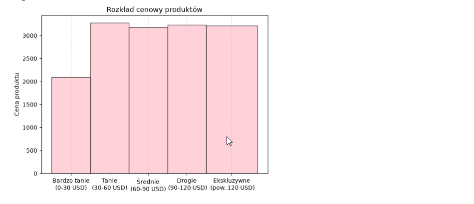
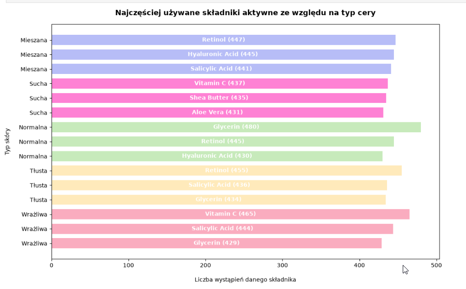
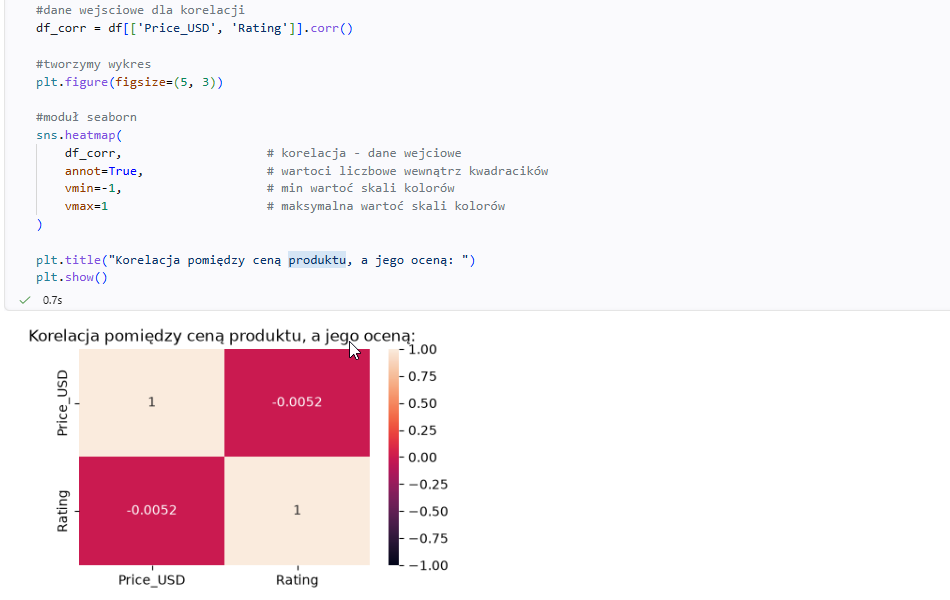

# Top_Beauty
Data analysis of cosmetic products

Source: Kaggle 

Link: https://www.kaggle.com/datasets/waqi786/most-used-beauty-cosmetics-products-in-the-world

### Goal: 
- ** analysis of top products and consumer preferences
- ** analysis of correlation between product price and customer ratings
- ** examination of ethical cosmetic testing trends and identification of main ingredients in products according to selected criteria
- ** business insight showing trends and preferences

### Technologies:
- Python 
-- pandas, matplotlib, seaborn, numpy 

###  First version: TopBeauty.py (06.03.2026)

### Extended version: TopBeauty.py (06.06.2026)*
improved and expanded with additional analysis – summary of further training and newly acquired skills. Information on what was changed is listed at the bottom*

### Extended version: TopBeauty.py (17.11.2026)*
common color palette and style.

### Insights:

- ** There is no correlation between product price and positive customer reviews

- ** Customers rate products from the categories Contour, Moisturizer, CC Cream the highest

- ** The type of product packaging and gender targeting does not show significant differences, except for Stick packaging. Why? This packaging type is associated with lipsticks, which are mostly dedicated to women :-)

- ** Among the best‑rated products for people with sensitive skin, 4 out of the top 5 are lip products. Why? Lips (exposed mucosa) are less prone to allergies when using surface‑acting cosmetics.

- ** There is no leader in ethical cosmetic production. Each country has a similar percentage of ethical products, around 50%.

### ⚠️ Data note:

The Kaggle dataset turned out to be synthetic and very specific - (mock data): prices and ratings are spread evenly, and product names often do not match their categories (for example "Ultra Face Mask" in the Blush category). The differences between groups are small, so the insights are just for 'practice and study of the analysis workflow', not real conclusions. I noticed it only while writing the Jupyter Notebook, but decided to finish the project as a study case. 

### 🧩 Extended version:
- ** enriched with additional charts – stacked bar chart, heatmap
- ** unified color scheme using a custom palette
- ** added new insights and questions
- ** full presentation prepared in Jupyter Notebook 

### Code update (extended 17.11.2026):
- ** TopBeauty.py and Analiza.ipynb now run smoothly
- ** repeated table formatting moved to one function in custom_styles.py 
- ** fixed price per ml calculation (price and size come from the same product) 
- ** cruelty-free chart shows the percentage of cruelty-free products per country 
- ** histogram Y axis renamed to "Number of products"
- ** requirements.txt cleaned up

### How to run the project locally:
- ** Clone the repository
- ** Install libraries: pip install -r requirements.txt
- ** Run the script: python TopBeauty.py or open Analiza.ipynb

View the notebook with colors: https://nbviewer.org/github/kamila-dudzinska/Top_Beauty/blob/main/Analiza.ipynb

### Sample visualizations and code:

### Original: TopBeauty.py (06.03.2026)

### Extended version: TopBeauty.py (06.06.2026)*

### Contact:  

  

--------------------------------------------POLISH VERSION --------------------------------------------------------
# Top_Beauty
Analiza danych dotyczących produktów kosmetycznych.

Źródło: Kaggle 

Link: https://www.kaggle.com/datasets/waqi786/most-used-beauty-cosmetics-products-in-the-world

### Cel:  
- ** analiza topowych produktów i preferencji konsumentów
- ** analiza korelacji między ceną produktu, a ocenami klientów 
- ** sprawdzenie trendu etycznego testowania kosmetyków oraz wskazanie głównych składników w produktach względem określonych kryteriów. 
- ** Insight dla biznesu pokazujący trendy i preferencje.

### Technologie:
- Python  
-- pandas, matplotlib, seaborn, numpy 

### Wersja pierwsza: TopBeauty.py (06.03.2026)

### Wersja rozszerzona: TopBeauty.py (06.06.2026)* 

Wersja poprawiona i rozszerzona o dodatkową analizę - podsumowanie kolejnych szkoleń i nowo nabytych umiejętności. Informacje co zostało zmienione na dole*

### Wersja rozszerzona: TopBeauty.py (17.11.2026)*

Wspólna paleta barw i styl.

### Insights (wnioski):
- ** Nie ma korelacji między ceną produktu, a pozytywnymi opiniami klientów
- ** klienci najlepiej oceniają produkty z kategorii Contour, Moister, CC Cream,
- ** Typ opakowania produktu, a targetowanie produktu według płci nie wskazuje zbyt dużych różnic, poza opakowaniem typu Stick. Dlaczego tak jest? 
Otóż ten typ opakowania, jest związany z pomadkami, a te z kolei w większości dedykowane są dla kobiet :-)
-** Wśród najlepiej ocenianych produktów dla osób ze skórą wrażliwą, w top5 znalazły się aż 4 produkty do ust. Dlaczego? Usta (wywinięta śluzówka) 
są mniej skłonne do alergii przy stosowaniu kosmetyków działających powierzchniowo. 
- ** Nie ma lidera wśród etycznego produkowania kosmetyków. Każdy z krajów na zbliżoną ilość procentową dla etycznych produktów i wynosi ok 50%. 

##  ⚠️ Uwaga o danych:
** --> Zbiór z Kaggle okazał się bardzo specyficzny (dane mockowe): ceny i oceny są równomiernie rozłożone, a nazwy produktów często nie odpowiadają przypisanym kategoriom (na przykład „Ultra Face Mask” znajduje się w kategorii Blush). Róznice między grupami są małe, dlatego uzyskane wnioski mają wartość głównie w kontekście ćwiczenia i nauki procesu analitycznego, a nie jako rzeczywiste konkluzje biznesowe. Zauważyłam to dopiero podczas pisania notatnika Jupyter Notebook, ale zdecydowałam się dokończyć projekt jako studium przypadku do celów edukacyjnych.

### 🧩 Wersja rozszerzona:
- ** wzbogacenie o dodatkowe wykresy - stacked bar chart, heatmap
- ** ujednolicenie szaty kolorystycznej o własną paletę barw
- ** dodanie nowych wniosków i pytań
- ** przygotowanie pełnej prezentacji w Jupyter Notebook

### Poprawki kodu (extended 17.11.2026):
** TopBeauty.py i Analiza.ipynb uruchamiają się i działają bez błedów
** formatowanie tabel przeniesione do jednej funkcji pokaz_tabele() w custom_styles.py 
** poprawione liczenie ceny za ml (cena i pojemność pochodzą z tego samego produktu) 
** wykres cruelty-free pokazuje teraz udział procentowy produktów cruelty-free w każdym kraju 
** oś Y histogramu podpisana "Liczba produktów"
** zaktualizowany requirements.txt

### Jak uruchomić projekt lokalnie:
1. Sklonuj repozytorium
2. Zainstaluj biblioteki: `pip install -r requirements.txt`
3. Uruchom skrypt: `python TopBeauty.py` lub otwórz `Analiza.ipynb`

Notebook z kolorami: https://nbviewer.org/github/kamila-dudzinska/Top_Beauty/blob/main/Analiza.ipynb

### Przykładowe wizualizacje i kod:

### Wersja pierwsza: TopBeauty.py (06.03.2026)

### Wersja rozszerzona: TopBeauty.py (06.06.2026)*

### Kontakt:  

